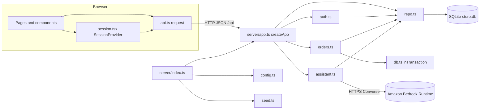
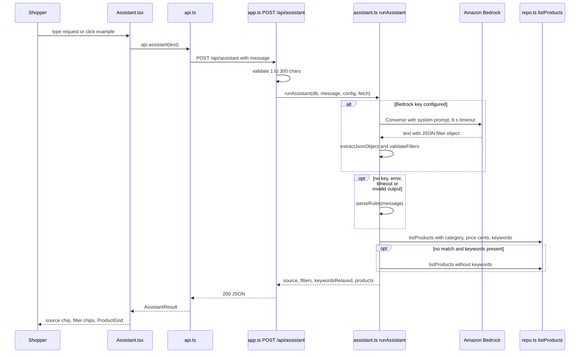
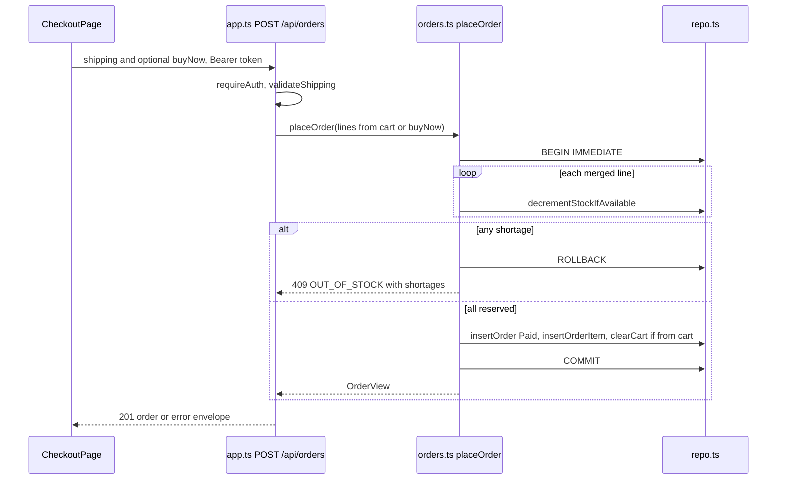
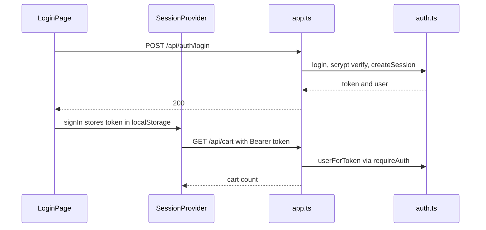

# Architecture

## Architecture Analysis

### System Overview

A single Node 24 process runs an Express 5 JSON API under `/api` and, in production (`npm start`), serves the Vite-built React SPA from `dist/` with an `index.html` fallback for client routes. Data lives in one SQLite file (`data/store.db`, `node:sqlite`, WAL). The only external system is Amazon Bedrock Runtime, called by the shopping assistant when a bearer key is configured. In development Vite (5173) proxies `/api` to the API (3001).

### Architectural Style

Modular monolith, layered by file (evidence: `server/app.ts` composes everything in `createApp`; no services or queues):

- Routing and input parsing: `server/app.ts`
- Domain logic: `server/orders.ts`, `server/auth.ts`, `server/assistant.ts`
- Data access: `server/repo.ts` (prepared statements only), schema in `server/db.ts`
- Cross-cutting: `server/errors.ts` (AppError), `server/config.ts` (env)
- Client: React SPA with a context store (`session.tsx`) and one typed fetch wrapper (`api.ts`)

Dependencies are injected through `AppOptions` (db, timings, assistant config, `now`, `fetchImpl`, `staticDir`), which is what makes the API testable without a port or real clock.

### Component Relationships

Text fallback: browser UI calls `api.ts`, which calls the Express app; the app routes to auth, orders and assistant modules, all of which read and write SQLite through `repo.ts`; the assistant may also call Bedrock. `index.ts` loads config, opens and seeds the DB, and starts the app. Full component list: `component-inventory.md`.

### Data Flow

- Requests carry JSON bodies (limit 50 kb) and, for cart and order routes, `Authorization: Bearer <token>`. `requireAuth` resolves the token to a user in `res.locals`.
- Handlers validate input, call domain functions with `db` and `now()`, and return JSON. Thrown `AppError`s become `{ error: { code, message, details } }`; anything else becomes a 500 with a generic message.
- Order status is derived from elapsed time on read (`deriveStatus`) and written back when it changed; there is no background job.
- Assistant: request text to filters (Bedrock or rules), filters (dollars) converted to cents, then `listProducts`. The model never supplies product data.
- Client keeps the session token in `localStorage` (`pc-store-token`) and cart count in context; order pages poll every 5 s.

### Key Design Decisions

- Built-in `node:sqlite` instead of a native driver: no compile step; synchronous calls make `BEGIN IMMEDIATE` transactions simple.
- Oversell protection by conditional `UPDATE ... WHERE stock >= ?` inside one transaction per order.
- LLM output treated as untrusted: strict JSON extraction and `validateFilters`, rule-based fallback on any failure or timeout (8 s), key only in a server-side header.
- Time-derived lifecycle with an injectable clock, so tests use fixed timestamps.
- Security headers set globally (`nosniff`, `X-Frame-Options: DENY`, `no-referrer`), `Cache-Control: no-store` on `/api`, `x-powered-by` disabled.

### Improvement Opportunities

- Assistant is stateless and single-turn; a chat experience needs either client-side history or a contract extension (see `api-documentation.md`).
- No rate limiting on the public assistant endpoint or on login.
- Shared types and the category list are duplicated between client and server (see `code-quality-assessment.md`).
- Listens on all interfaces; intended for a trusted network.

## Interaction Diagrams

### Shopping assistant request (existing; basis for the chat widget)

Text fallback: the panel posts the message; the server validates it, gets filters from Bedrock or the rule parser, queries the catalog (retrying without keywords if needed) and returns source, filters and products, which the panel renders as chips and product cards.

### Checkout (place order)

Text fallback: checkout posts shipping data; within one immediate transaction each line's stock is conditionally decremented; any shortage rolls everything back with a 409, otherwise the order is inserted as Paid, the cart cleared, and the order view returned.

### Login and authenticated request

Text fallback: login verifies the scrypt hash and creates a session token; the client stores it and sends it as a bearer header; `requireAuth` resolves it on every protected route, and a 401 clears the local session.
